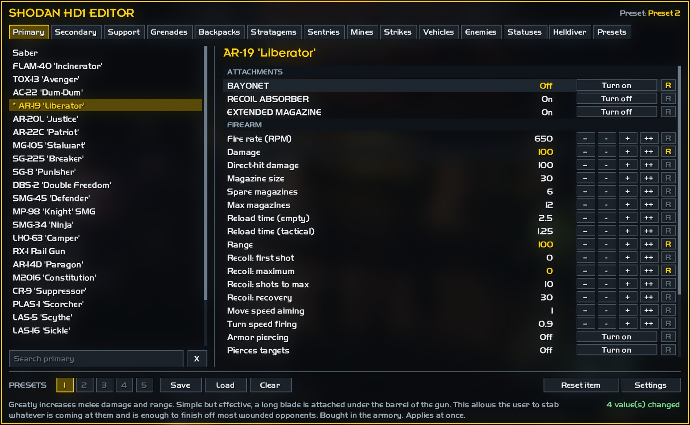

# SHODAN HD1 Editor

Change the stats of weapons, grenades, backpacks, stratagems, sentries, mines, strikes, vehicles,
enemies, status effects and your Helldiver in **Helldivers** (the first one).
Press **F7** in game, pick an item, change its numbers, and the change applies at once. Your changes
stay for the next launch.

**[Download the latest release](../../releases/latest)**· Nothing else needed

## What you can do

- **Edit stats live**: every value, per item.
- **Attachments**: turn each weapon's armory upgrades on and off, bought or not. Your save is left as it is.
- **Presets**: 5 per item, and up to 50 named presets in the Presets tab for everything you have changed.
- **Settings**: turn all your changes off and on again, pick how see-through the window is, hide the key hints, and hide tabs you don't use.

## Install

1. Download `SHODAN-HD1-Editor-<version>.zip` from the [latest release](../../releases/latest) and unzip it.
2. Close the game, then double-click `Install.bat`.
3. Start Helldivers and press **F7**.

To take it out, double-click `Uninstall.bat`. Verifying the game files in Steam also takes it out, and a
game update may too: run `Install.bat` again after one.

## Keys

| Key | What it does |
|---|---|
| F7 | Open or close the window |
| Up / Down | Choose a stat |
| Left / Right | Change it (hold Shift for bigger steps) |
| Enter | Type a value |
| Del | Put the stat back to the game's value |
| PgUp / PgDn | Previous / next item |
| Tab | Next tab (Shift: previous) |
| Esc | Close |

## Notes

- Leaderboard scores aren't sent while the editor is installed. Galactic War progress is sent as usual.
- Some values apply at once, others on the next call-in, spawn or mission. The line under the stats says which.
- An item whose data the game hasn't loaded on the current screen says so. Open it on the ship or in a mission.
- Your edits and presets are kept in `%LOCALAPPDATA%\SHODAN\SHD1Editor`.
- Works with other mods. If another mod tool installed first, the editor keeps its mods running. A mod tool installed after it may replace the editor: run `Install.bat` again.
- Made for solo play.

## License

GPL-3.0. See [LICENSE](LICENSE). Third-party notices: [THIRD-PARTY-NOTICES.txt](THIRD-PARTY-NOTICES.txt).
